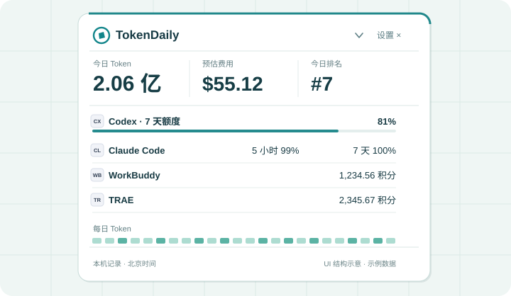

<p align="center">
  
</p>

<h1 align="center">AI 用了多少，额度还剩多少，一眼看清。</h1>

<p align="center">TokenDaily 是常驻桌面的个人 AI 用量与额度助手。悬浮球收在屏幕边缘，需要时展开；详细记录点开再看。</p>

<p align="center">
  <a href="https://tokendaily.net/">下载 Windows 版</a> ·
  <a href="docs/FEATURE_PARITY.md">查看平台状态</a> ·
  <a href="docs/ARCHITECTURE.md">了解数据边界</a>
</p>

<p align="center">
  
</p>

<p align="center"><sub>界面结构示意 · 数字为示例，不代表真实账户、订阅账单或实时排名</sub></p>

## 一屏看清

| 今日用量 | 额度与积分 | 每日记录 |
| --- | --- | --- |
| 汇总已接入工具的本地可读 Token，按北京时间 00:00 切日。 | Codex、Claude 的额度和 WorkBuddy、TRAE 的积分分别显示；来源未返回的数据保持未知。 | 日历查看总 Token 历史，点击组件进入来源详情。 |

悬浮窗顶部的**今日 Token、预估费用、今日排名**可以调整顺序或隐藏。排名读取北京时间当日的多工具总榜，以已同步量为准；详情窗口的周榜独立保留。费用是等效 API 估算，并非实际账单。参榜需主动选择，默认不上传用量。

- **随手展开与收起**：鼠标悬停展开，右上角「收起」按钮恢复悬浮球；已贴边时恢复半球。收起与「关闭悬浮窗」是两个独立操作。
- **按习惯摆放**：支持贴边隐藏、单键或组合快捷键；长按进入组件编辑，调整顺序、移除或恢复组件。
- **详情按需打开**：点击指标、来源卡片或日历查看详情，右上角进入设置。主窗口集中管理来源、提醒与悬浮窗。

## 接入范围

| 工具 | 本地 Token 记录 | 额度或积分 |
| --- | --- | --- |
| **Codex** | 只读本机日志 | 只展示账户来源实际返回的额度窗口 |
| **Claude Code / Desktop** | Claude Code 本机日志；Mac 已核对 Desktop「Code」标签页生成的 Code 日志，普通网页和桌面聊天 Token 不在统计范围 | 优先使用有效 Code 订阅登录；无有效登录时，Windows / macOS 均可尝试 Desktop 本机额度记录，标明采样时间与账户未核验 |
| **WorkBuddy** | 可读取的本机记录 | 官方网页登录后查询积分 |
| **TRAE CN** | 可读取的本地记录，可能含恢复或同步的会话 | 独立官方登录后查询积分 |

Codex 与 Claude 按来源实际返回的数据展示额度窗口及重置时间，不写死为单一的 5 小时或 7 天窗口。Claude Desktop 本机记录默认没有重置时间，账户未核验时不触发额度提醒；Mac 另有默认关闭的 Claude Code 状态栏桥接选项，可在确认后补充同一组织的重置时间，关闭时还原原配置。

WorkBuddy / TRAE 保留最后一次成功读取的积分，重启先标为旧数据，再向官方更新；临时网络失败会重试。额度百分比、积分和 Token 分别展示，读取失败、记录过期或来源未接入时显示相应状态，不以零代替。详情见 [Claude](docs/CLAUDE.md)、[WorkBuddy](docs/WORKBUDDY.md)、[TRAE](docs/TRAE.md) 和 [费用说明](docs/API_COST.md)。

## 从这里开始

1. 从 [TokenDaily 官网](https://tokendaily.net/)下载 Windows x64 安装包。仓库源码目前为 0.1.28，官网版本以下载页为准。
2. 在设置中接入本机正在使用的工具，并按需开启悬浮窗、贴边隐藏与快捷键。
3. 点击悬浮窗的指标、来源卡片或日历查看详情。参榜前可预览将上传的统计数据；不参榜也能使用本机监测。

Windows 支持应用内检查更新；发现已发布新版后，可从悬浮窗右上角下载、验签并原位更新，保留设置和身份。源码版本与官网已发布版本可能不同，详见 [应用更新](docs/UPDATES.md)。

> **平台状态**：Windows 是当前公开下载平台。Intel Mac 0.1.28 已完成本机安装态的日榜与主动收起验证，Claude 订阅额度、真实 Code 日志等也有分项验收记录；仍有交互和双设备场景待验。Intel + Apple Silicon 通用 App 已交叉构建，Apple Silicon 实机未验收。Mac 尚未完成正式签名、公证或公开下载，官网更新通道也未开放。[查看逐项验证状态](docs/FEATURE_PARITY.md)。

<details>
<summary><strong>用量怎样刷新？面板如何收起？</strong></summary>

本机日志日内按增量读取，结合目录事件、近期文件检查和定时补查发现新记录，不每两秒重扫全部日志。今日统计按北京时间 00:00 切日；已正常接入且当日尚无用量时显示 0，日志不可读时显示异常。悬浮窗右下角可手动刷新，额度与积分仍受各来源的刷新间隔限制。

鼠标移开后面板通常自动收起，也可点击右上角「收起」按钮；普通浏览时 Esc 可主动收起，组件编辑／拖动时先取消相应状态。Mac 的 Esc 需要 TokenDaily 为活动应用且指针位于已展开面板内；其他应用持有键盘时，按键仍由该应用处理。也可在设置中绑定快捷键，按一次展开保持，再按一次收起。

</details>

<details>
<summary><strong>数据与排行榜怎样处理？</strong></summary>

默认只在本机读取可接入记录，不上传对话、原始日志或第三方凭据。游客可自愿参榜；当前多工具总榜汇总 Codex、Claude Code、WorkBuddy，TRAE 尚未计入。名次以当前已同步数据为准。Windows 已验证官网账号连接与最新用量优先上传；Mac 更新连接和真实双设备汇总、去重仍待验收。每台设备需分别从应用连接同一账号，本机用量与账号汇总分别展示。参榜范围与清除方式见 [排行榜说明](docs/LEADERBOARD.md)。

</details>

<details>
<summary><strong>如何在本地运行？</strong></summary>

桌面端使用 Tauri 2、React/TypeScript 和 Rust。安装对应平台的 Node.js、Rust 与 Tauri 构建依赖后运行：

```bash
npm ci
npm test
npm run build
npm run tauri dev
```

Windows 还需要 Microsoft C++ Build Tools、Windows SDK 和 WebView2。平台配置与开发约定见 [架构](docs/ARCHITECTURE.md)、[双机协作](docs/DEVELOPMENT_WORKFLOW.md)和[应用更新](docs/UPDATES.md)。

</details>

## 开源与参与

TokenDaily 桌面端免费提供，原始源码与文档采用 [Apache-2.0](LICENSE)，版权及第三方声明见 [NOTICE](NOTICE) 和 [THIRD_PARTY_NOTICES](THIRD_PARTY_NOTICES.txt)。第三方依赖和品牌素材遵循各自条款，Apache-2.0 不授予品牌商标使用权。

欢迎改进来源适配、平台兼容、测试与文档。开始前请读 [贡献指南](CONTRIBUTING.md)；漏洞报告、数据读取和可选同步边界见 [安全说明](SECURITY.md)。贡献和本机监测无需购买网页订阅。官网的 AI 工具情报、优惠与更新提醒订阅是独立经营的服务，不包含在本桌面源码分发中。

在 [GitHub 公开仓库](https://github.com/yangdonghan50/TokenDaily) 提交问题和参与共建。公开历史从经过脱敏审查的初始快照开始，检查范围和发布方式见 [开源审查记录](docs/OPEN_SOURCE_REVIEW.md)。请勿提交账户凭据、对话、原始日志、数据库或签名材料。最新已验证能力与限制见 [功能对照](docs/FEATURE_PARITY.md)和[开发进度](docs/PROGRESS.md)。
