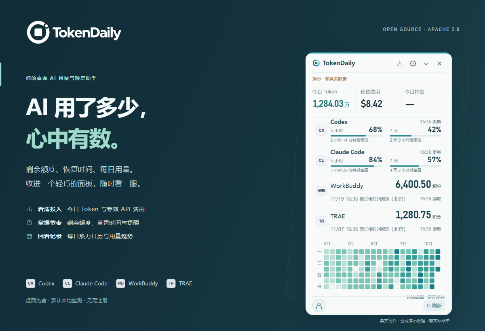
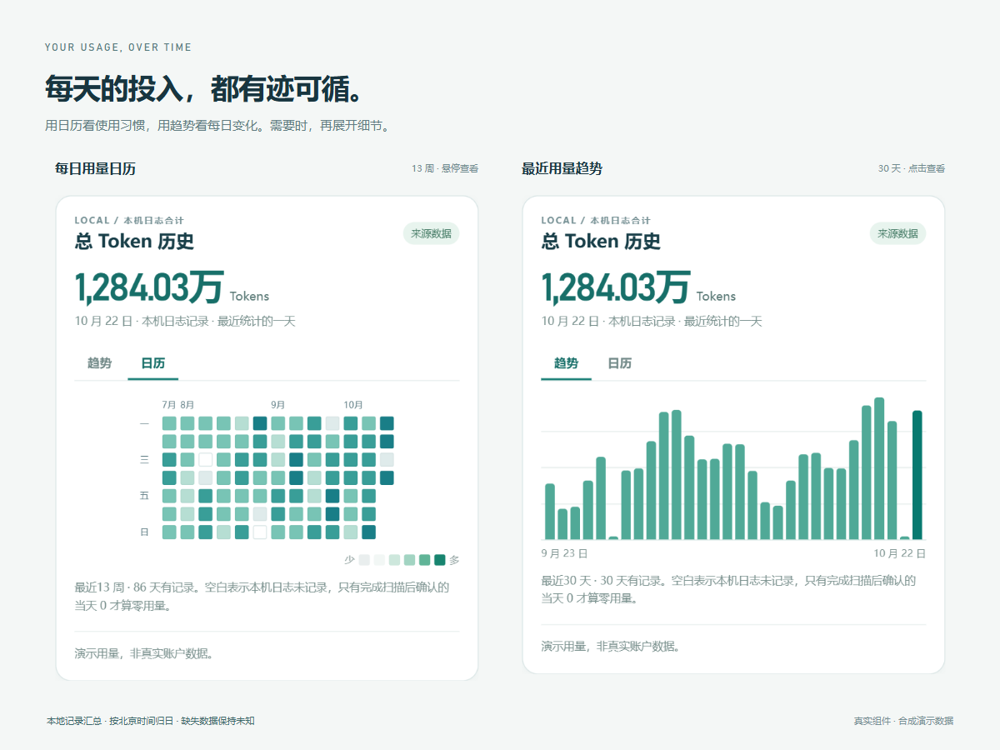

<p align="center">
  
</p>

<p align="center"><strong>今日用了多少，下次何时恢复。抬眼就知道。</strong></p>

<p align="center">TokenDaily 将 AI 用量、剩余额度与积分收进一个轻巧的桌面面板。<br>工作时留在屏幕边缘，需要时展开，详细记录点开再看。</p>

<p align="center">
  <a href="https://tokendaily.net/">下载 Windows 版</a> ·
  <a href="#三步开始">快速开始</a> ·
  <a href="CONTRIBUTING.md">参与共建</a> ·
  <a href="docs/FEATURE_PARITY.md">平台状态</a>
</p>

<p align="center"><sub>桌面免费 · Apache-2.0 · 默认本地 · 无需注册即可监测</sub></p>

## 每天会用到的功能

| 想知道什么 | TokenDaily 如何呈现 |
| --- | --- |
| **今天用了多少 Token** | 汇总已接入工具的可读记录，也可分别查看各来源。按北京时间 00:00 切日，缓存与推理不重复累计。 |
| **额度还剩多少，何时恢复** | 展示 Codex、Claude 实际返回的额度窗口、剩余比例和重置时间；缺失字段保持未知。 |
| **积分还够不够** | 分别查看 WorkBuddy、TRAE 的积分余额与详情。保留最近一次成功结果及查询时间，旧数据明确标记。 |
| **最近用量怎样变化** | 趋势图点击查看每日总用量，热力日历通过悬停或键盘查看；各来源的今日用量、额度与积分另有详情。 |
| **这些用量相当于多少费用** | 对可识别模型及完整计数字段，按已核验单价计算等效 API 美元费用，标明覆盖范围。它是参考估算，不是订阅账单。 |
| **何时需要留意额度** | 为已核验身份的 Codex、Claude 额度设置 10% / 20% / 30% 低额提醒；新的可靠数据确认恢复后才提醒。 |
| **怎样随时查看又少打扰** | 托盘常驻、悬浮球、贴边隐藏、全局快捷键。长按进入组件编辑，排序、隐藏或恢复需要的信息。 |
| **是否参与公开排名** | 游客预览确认后参榜；官网账号可主动连接设备同步用量，公开参榜另行选择。悬浮窗查看今日排名，详情可看周榜。 |
| **怎样保持应用更新** | Windows 支持用户主动下载新版、校验更新签名并原位安装，保留设置与身份。 |

<p align="center">
  
</p>

<p align="center"><sub>展示图使用合成数据，仅说明界面与功能，不代表真实账户、实际账单或实时排名。</sub></p>

### 按你的工作习惯摆放

普通悬浮球**点击展开**；开启贴边隐藏后，拖到左右屏幕边缘可收成半球，贴边后**悬停展开**。鼠标移开自动收起；也可使用右上角收起按钮或设置全局快捷键，主动展开保持与收起。

顶部的今日 Token、预估费用、今日排名可独立隐藏、左右排序；下方额度、积分与日历组件可增删、上下排序。偏好保存在本机，隐藏组件不停止对应来源采集。点击指标、来源卡片或日历进入详情，设置集中管理来源、提醒与本地数据；Windows 安装版还可设置开机启动。

## 已接入的工具

| 来源 | Token 统计 | 额度或积分 |
| --- | --- | --- |
| **Codex** | 本机 Codex 日志 | 账户来源实际返回的额度窗口与重置时间 |
| **Claude Code / Desktop** | Claude Code 本机日志，含子代理；不包含普通网页或桌面聊天 Token | 优先使用有效 Code 订阅登录；也可读取 Desktop 本机额度记录，并标明采样时间与账户未核验 |
| **WorkBuddy** | 可读取的本机 projects 日志 | 独立官方网页登录后查询积分 |
| **TRAE CN** | 本地数据库中的可读记录，可能含恢复或同步的会话 | 独立官方网页登录后查询积分 |

**额度、积分和 Token 各有来源与口径。** Token 不反推套餐剩余额度，也不换算积分；本地记录不代表所有设备或当前账号的完整用量。未接入、读取失败和过期状态分别展示，不用零填补未知。

接入细节：[Codex 可行性](docs/FEASIBILITY.md) · [Claude](docs/CLAUDE.md) · [WorkBuddy](docs/WORKBUDDY.md) · [TRAE](docs/TRAE.md) · [费用口径](docs/API_COST.md)

## 三步开始

1. **下载安装**：前往 [TokenDaily 官网](https://tokendaily.net/) 下载 Windows x64 安装包。源码当前为 `0.1.28`，已发布版本以官网为准。
2. **连接来源**：在设置中接入正在使用的工具；需要官方登录的来源，按界面提示完成授权。
3. **放在手边**：按需开启悬浮窗、贴边隐藏、快捷键与提醒。本机监测无需 TokenDaily 账号，参榜始终由你选择。

### 平台进展

| 平台 | 当前状态 |
| --- | --- |
| **Windows x64** | 当前公开下载平台。已有安装态功能验收与签名更新验证；逐项结果见功能对照。 |
| **macOS · Intel** | 已有本机安装与多项原生功能验证，部分交互及双设备场景待验。尚未完成正式签名、公证与公开分发，官网更新通道未开放。 |
| **macOS · Apple Silicon** | Intel / Apple Silicon 通用 App 已交叉构建；Apple Silicon 实机运行尚未验收。 |

平台实现与实际验收分别记录，不将一端的测试结果视为另一端通过。详见 [功能对照](docs/FEATURE_PARITY.md) 与 [应用更新](docs/UPDATES.md)。

## 数据留在你掌控之中

本地监测默认不上传用量，不上传对话、提示词、原始日志或第三方凭据，也不发起模型推理来刷新额度。退出或断开 TokenDaily 不注销你的 Codex，不自动续跑任务、购买额度或消费重置券。

账号同步与公开排名均由用户主动选择：游客参榜提供上传预览；官网设备连接经浏览器批准后会自动同步所选范围的用量，公开参榜另行选择。仅同步必要统计与去重信息，创建身份或连接账号不等于同意公开参榜。当前多工具总榜包含 Codex、Claude Code、WorkBuddy，TRAE 尚未上传。账号多设备连接已有实现，真实双设备汇总仍待完整验收。说明见 [排行与同步边界](docs/LEADERBOARD.md) 和 [安全说明](SECURITY.md)。

<details>
<summary><strong>统计周期、刷新与来源限制</strong></summary>

- 今日统计按北京时间归日；趋势展示最近 30 天，详情热力日历展示最近 13 周，悬浮日历展示最近 20 周。历史只覆盖可读取的记录，缺失日期不补零。
- 本机日志结合增量读取、目录事件与定时补查刷新。日历按需读取并缓存；手动刷新仍遵守各来源间隔。网络失败会重试，保留旧结果时标明更新时间。
- Claude 普通网页和桌面聊天的精确 Token 未接入。Mac 已核对 Desktop「Code」标签页产生的 Code 日志，不等于已覆盖普通聊天。
- Claude Desktop 本机额度记录默认没有重置时间，账户未核验时不触发提醒。Mac 可选的 Code 状态栏桥接默认关闭，经确认后才补充同一组织的重置时间，关闭时还原原配置。
- 额度提醒依据新的可靠数据并持久化去重；倒计时结束不代表恢复，不自动重启或续跑任务。
- WorkBuddy / TRAE 的积分是官方查询结果；到期时间不冒充额度重置时间，也不触发百分比额度提醒。费用当前不能为这两个来源套价；未核验模型或缺少必要字段时，标记待估价或部分覆盖。
- 普通浏览时 Esc 可收起悬浮窗，编辑或拖动时先取消当前操作。Mac 需要 TokenDaily 为活动应用且指针位于展开面板内；其他应用持有键盘时可使用已设置的全局快捷键。
- Windows 已验证官网账号连接与最新用量优先上传；Mac 更新连接及真实双设备汇总、去重仍待验收。本机用量与账号汇总分别展示。

</details>

## 本地开发与贡献

技术栈为 **Tauri 2 + React / TypeScript + Rust**。准备 Node.js 24 或兼容的更新版本、Rust stable 与对应系统的 Tauri 构建依赖后运行：

```bash
git clone https://github.com/yangdonghan50/TokenDaily.git
cd TokenDaily
npm ci
npm test
npm run build
npm run tauri dev
```

Windows 需要 C++ Build Tools、Windows SDK 和 WebView2；macOS 需要 Xcode Command Line Tools。普通开发无需发布签名私钥；可在开发服务器使用 `?demo=normal` 查看明确标记的合成数据。

欢迎从来源适配、平台兼容、解析测试或文档开始。请先阅读 [贡献指南](CONTRIBUTING.md)，其中包含工具链、验证命令与分支约定；架构和最新进度见 [ARCHITECTURE](docs/ARCHITECTURE.md) 与 [PROGRESS](docs/PROGRESS.md)。发现漏洞，请使用 [GitHub 私密漏洞报告](https://github.com/yangdonghan50/TokenDaily/security/advisories/new)，不要在公开 Issue 中粘贴敏感信息。

## 开源许可

TokenDaily 桌面端免费提供，原始源码与文档采用 [Apache-2.0](LICENSE)。版权及第三方声明见 [NOTICE](NOTICE) 和 [THIRD_PARTY_NOTICES](THIRD_PARTY_NOTICES.txt)；第三方依赖遵循各自许可，Apache-2.0 不授予品牌商标使用权。

官网的 **AI 工具情报、优惠与更新提醒订阅**是独立运营的服务，不包含在本桌面源码分发中。使用桌面监测或参与贡献均无需购买网页订阅。
