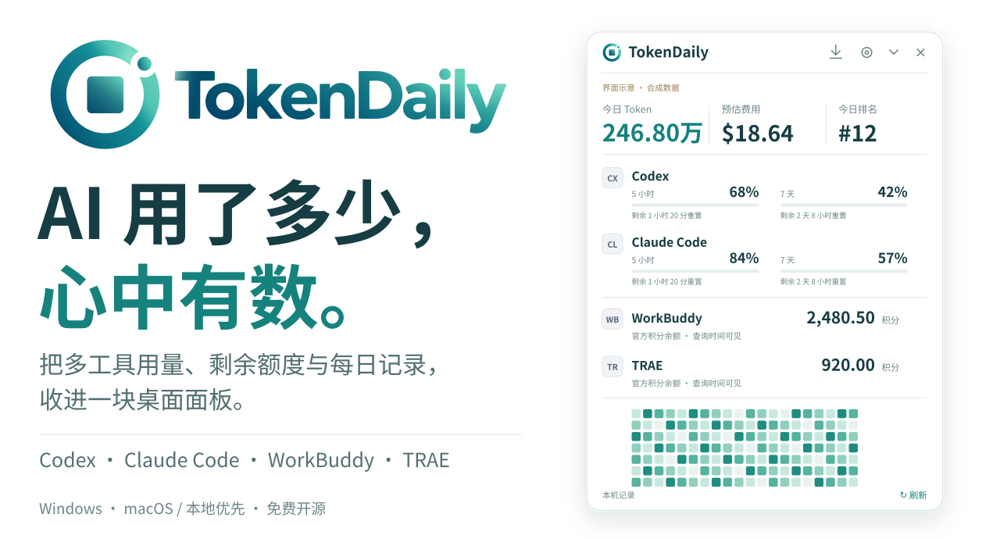
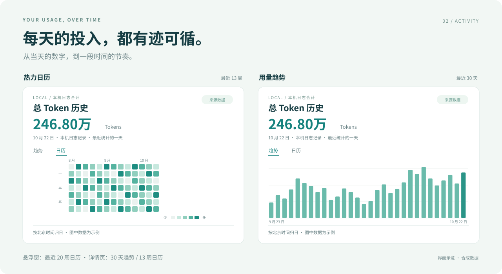
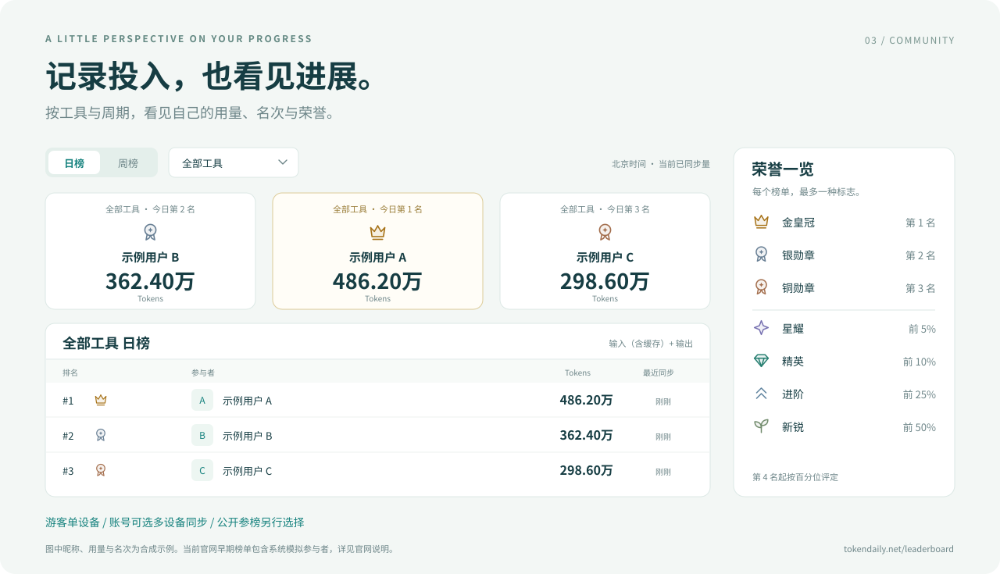

<p align="center">
  <a href="https://tokendaily.net/zh/"></a>
</p>

<p align="center"><strong>常驻桌面的个人 AI 用量与额度助手</strong></p>
<p align="center">今日用了多少，额度还剩多少，何时恢复。抬眼就能看见。</p>

<p align="center">
  <a href="https://tokendaily.net/zh/"><strong>下载 Windows 版</strong></a> ·
  <a href="#快速开始">快速开始</a> ·
  <a href="https://tokendaily.net/leaderboard/">社区榜单</a> ·
  <a href="CONTRIBUTING.md">参与共建</a>
</p>

<p align="center"><sub>桌面免费 · Apache-2.0 · 默认本地 · 无需注册即可监测</sub></p>

<p align="center"></p>

<p align="center"><sub>所有展示图均为合成示意，不代表真实账户、实际账单或实时排名。</sub></p>

## 一眼看清，按需展开

- **今日用量**：汇总已接入工具的 Token，按北京时间归日，可查看各来源详情。
- **额度与积分**：查看 Codex、Claude 的剩余额度与重置时间，以及 WorkBuddy、TRAE 的官方积分。
- **费用参考**：按已核验模型与计数估算等效 API 费用，标明覆盖范围；不代表实际账单。
- **及时提醒**：低额度与确认恢复提醒，依据可靠的新数据触发并去重。
- **随手查看**：托盘、悬浮球、贴边隐藏和快捷键；组件可排序、隐藏与恢复。
- **保持更新**：Windows 支持主动下载、验签并原位更新，保留设置与身份。

<p align="center"></p>

日历看使用习惯，趋势看每日变化。悬浮窗展示 **20 周日历**，详情可切换 **30 天趋势 / 13 周日历**。历史覆盖可读取的本地记录，缺失日期不补零。

## 自愿参榜，记录投入

<p align="center"></p>

查看日榜、周榜、工具分榜与个人荣誉，也可生成分享卡。当前总榜包含 **Codex、Claude Code、WorkBuddy**，TRAE 暂不上传；早期榜单含系统模拟参与者。

游客可自愿参榜；官网账号连接经浏览器批准后会同步可读取历史，**公开参榜另行选择**。真实双设备汇总仍待完整验收。[打开榜单](https://tokendaily.net/leaderboard/) · [同步与排名规则](docs/LEADERBOARD.md)

## 已接入的工具

| 来源 | Token 记录 | 额度或积分 |
| --- | --- | --- |
| [Codex](docs/FEASIBILITY.md) | 本机日志 | 实际返回的额度窗口与重置时间 |
| [Claude Code / Desktop](docs/CLAUDE.md) | Code 日志，含子代理 | Code 订阅优先；无有效登录时尝试 Desktop 本机记录 |
| [WorkBuddy](docs/WORKBUDDY.md) | 可读取的本机日志 | 独立官方登录后查询积分 |
| [TRAE CN](docs/TRAE.md) | 本地数据库记录，可能含同步会话 | 独立官方登录后查询积分 |

普通 Claude 网页和 Desktop 聊天的精确 Token 未接入。Token 不反推额度或积分；未知、失败和过期分别标明，本地记录不代表账号全部设备用量。[费用口径](docs/API_COST.md) · [来源与平台细节](docs/FEATURE_PARITY.md)

## 快速开始

1. **安装**：前往 [官网](https://tokendaily.net/zh/) 下载 Windows x64 版。
2. **接入**：在设置中连接正在使用的工具，确认读取状态。
3. **查看**：按习惯开启悬浮窗、快捷键和提醒，点击指标查看详情。

**Windows** 是当前公开下载平台。**macOS Intel** 已有本机验证，尚未正式签名、公证或公开分发；**Apple Silicon** 已交叉构建，实机未验收。[平台状态](docs/FEATURE_PARITY.md) · [应用更新](docs/UPDATES.md)

## 本地优先，开放共建

本地监测无需注册，默认不上传用量。不向 TokenDaily 上传对话、提示词、原始日志或第三方凭据，也不为刷新额度发起模型推理。账号同步与公开参榜由你主动选择。[隐私与安全](SECURITY.md)

使用 **Tauri 2 + React / TypeScript + Rust**。准备好 [开发依赖](CONTRIBUTING.md#本地开发) 后运行：

```bash
git clone https://github.com/yangdonghan50/TokenDaily.git
cd TokenDaily
npm ci
npm run tauri dev
```

欢迎贡献来源适配、平台兼容、测试与文档。[贡献指南](CONTRIBUTING.md) · [问题反馈](https://github.com/yangdonghan50/TokenDaily/issues) · [私密漏洞报告](https://github.com/yangdonghan50/TokenDaily/security/advisories/new)

桌面源码采用 [Apache-2.0](LICENSE)，版权与第三方声明见 [NOTICE](NOTICE) 和 [THIRD_PARTY_NOTICES](THIRD_PARTY_NOTICES.txt)。官网 **AI 工具情报、优惠与更新提醒订阅**独立运营，使用桌面端或参与贡献无需订阅。
